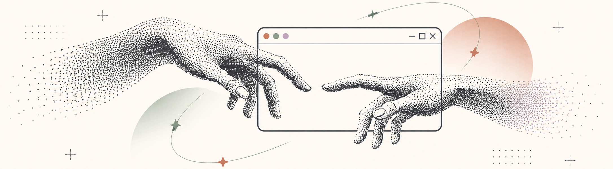

<h1>Thulasi G T</h1>

<strong>Computer Science &amp; Information Technology Student</strong>

REVA University · Bangalore

<code>BUILD</code> &nbsp;·&nbsp; <code>LEARN</code> &nbsp;·&nbsp; <code>EXPLORE</code> &nbsp;·&nbsp; <code>CREATE</code>

  

---

## About Me

Hi, I'm **Thulasi G T**, a Computer Science and Information Technology student at **REVA University, Bangalore**.

I'm passionate about building practical solutions and exploring how technology can solve real-world problems.

I enjoy learning through hands-on projects, experimenting with new tools, and collaborating with people who share the same curiosity.

**Currently exploring:**

- Artificial Intelligence, AI Agents and LLMs
- Machine Learning
- AWS and Google Cloud
- Full-stack development
- Data Structures and Algorithms
- Open-source development

Beyond technology, I enjoy drawing, art and creative work. I'm also interested in entrepreneurship and building meaningful products.

 

---

## 🌱 What I'm Exploring

<table>
<tr>
<td width="50%" valign="top">

<h3>01 · Artificial Intelligence</h3>

Exploring AI agents, machine learning, LLMs and practical AI applications.

</td>
<td width="50%" valign="top">

<h3>02 · Cloud Computing</h3>

Learning AWS, Google Cloud, infrastructure, deployment and cloud fundamentals.

</td>
</tr>
<tr>
<td width="50%" valign="top">

<h3>03 · Software Development</h3>

Building applications and strengthening programming and backend skills.

</td>
<td width="50%" valign="top">

<h3>04 · Open Source &amp; DSA</h3>

Practising problem-solving and learning collaborative development.

</td>
</tr>
</table>

---

## 🛠️ Tech Stack

<strong>Programming Languages</strong>

<strong>Frontend Development</strong>

<strong>Backend &amp; Databases</strong>

<strong>AI, Data &amp; Automation</strong>

  

<strong>Cloud &amp; Developer Tools</strong>

<strong>Blockchain Exploration</strong>

---

## 📊 GitHub Analytics

  

---

## 📈 Contribution Activity

---

## 🏆 GitHub Achievements

---

## 🐍 Contribution Journey

---

## Let's Connect

I'm always happy to meet people who enjoy learning, building, sharing ideas, and exploring technology together.

 

<a href="https://www.linkedin.com/in/thulasi-rame-gowda-014374382/">LinkedIn</a>
&nbsp; · &nbsp;
<a href="https://github.com/thulasiramegowda">GitHub</a>
&nbsp; · &nbsp;
<a href="https://x.com/thulas_21">X</a>
&nbsp; · &nbsp;
<a href="mailto:thulasiramegowda29@gmail.com">Email</a>

  

**Learning continuously. Building with curiosity. Creating with purpose.**

 

Made with curiosity and a little creativity.

