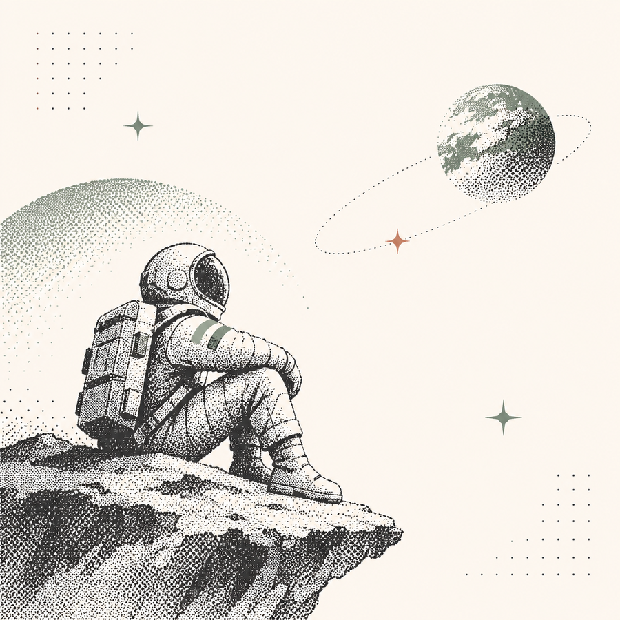

THULASI G T
Computer Science & Information Technology Student · REVA University

BUILD  ·  LEARN  ·  EXPLORE  ·  CREATE

<table>
<tr>
<td width="62%" valign="top">/ About Me
Hi, I'm Thulasi G T, a Computer Science and Information Technology student at REVA University, Bangalore.

I enjoy building practical solutions, experimenting with technologies, and learning how different parts of software work together. My main interests are Artificial Intelligence, Cloud Computing, and Software Development.

I'm learning through hands-on projects, hackathon work, technical communities, and improving my programming fundamentals.

Currently exploring
- AI agents, machine learning, and LLM applications
- AWS, Google Cloud, and cloud deployment
- Full-stack development and backend integration
- Data Structures & Algorithms
- Open-source collaboration
Outside technology, I enjoy drawing and creative work. I'm also curious about entrepreneurship and building useful products.
</td>
<td width="38%" valign="middle" align="center">
Curious by nature. Creative by habit.
</td>
</tr>
</table>A little about how I think
const thulasi = {
  education: "B.Tech CSIT @ REVA University",
  interests: ["AI", "Cloud", "Software Development"],
  exploring: ["AI Agents", "Machine Learning", "AWS", "DSA"],
  mindset: "Learn -> Build -> Improve",
  creativeSide: "Artist"
};
/ Areas I'm Exploring
<table>
<tr>
<td width="50%" valign="top">01 · Artificial Intelligence

Exploring AI agents, machine learning, LLMs, and practical AI applications.
</td>
<td width="50%" valign="top">
02 · Cloud Computing

Learning AWS, Google Cloud, deployment, infrastructure, and cloud fundamentals.
</td>
</tr>
<tr>
<td width="50%" valign="top">
03 · Software Development

Building full-stack applications and improving programming and backend skills.
</td>
<td width="50%" valign="top">
04 · Open Source & DSA

Practising problem-solving and learning to collaborate on shared codebases.
</td>
</tr>
</table>/ Selected Projects
A few projects and experiments from my learning journey. They are at different stages of development; the descriptions below reflect their current scope.
<table>
<tr>
<td width="50%" valign="top">KrishiSetu
A farmer-support platform exploring market predictions, multilingual assistance, and agricultural labour support.

Stack: React · Tailwind CSS · Node.js · Express · MongoDB · Gemini API · Bhashini
</td>
<td width="50%" valign="top">MANGANAI
A university hackathon MVP exploring satellite data, remote sensing, and AI/ML approaches for manganese prospectivity.

Status: In development

Focus: Earth Observation · Remote Sensing · AI/ML · Geospatial Analysis
</td>
</tr>
<tr>
<td width="50%" valign="top">AQUA-ETHIC
An environmental-monitoring concept exploring satellite observations, IoT sensor data, and blockchain-based data integrity.

Focus: Remote Sensing · IoT · Node.js · PostgreSQL · Blockchain
</td>
<td width="50%" valign="top">SafetyVision
A computer-vision prototype for helmet detection using transfer learning with MobileNetV2.

Stack: Python · TensorFlow · MobileNetV2 · Flask · React · Node.js
</td>
</tr>
<tr>
<td colspan="2" valign="top">Blockchain Sandbox
A hands-on learning repository for Ethereum smart contracts and blockchain integration. Includes a Node.js/Express experiment that hashes simulated sensor data and sends the hash to a smart contract.

Stack: JavaScript · Node.js · ethers.js · Ethereum · Hardhat · SHA-256
</td>
</tr>
</table>/ Tech Stack
Technologies I've worked with or am currently exploring. This is a learning snapshot, not a claim of expertise in every tool.

Programming languages

Frontend development

Backend & databases

AI, data & automation

Cloud & developer tools

/ GitHub Analytics

Contribution activity

GitHub achievements

/ Contribution Snake

Let's Connect
I'm always happy to meet people who enjoy learning, building, sharing ideas, and working on meaningful projects.

<a href="https://www.linkedin.com/in/thulasi-rame-gowda-014374382/">LinkedIn</a>  · 
<a href="https://github.com/thulasiramegowda">GitHub</a>  · 
<a href="https://x.com/thulas_21">X</a>  · 
<a href="mailto:thulasiramegowda29@gmail.com">Email</a>

Learning continuously. Building with curiosity. Creating with purpose.

